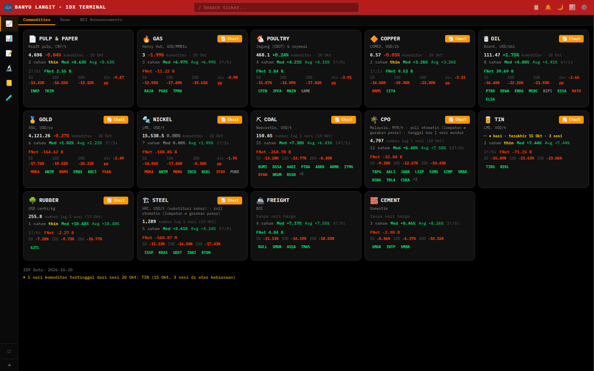
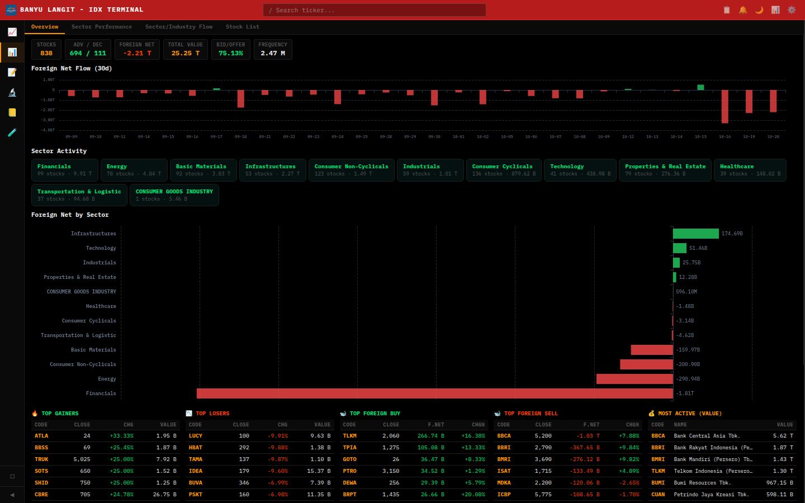
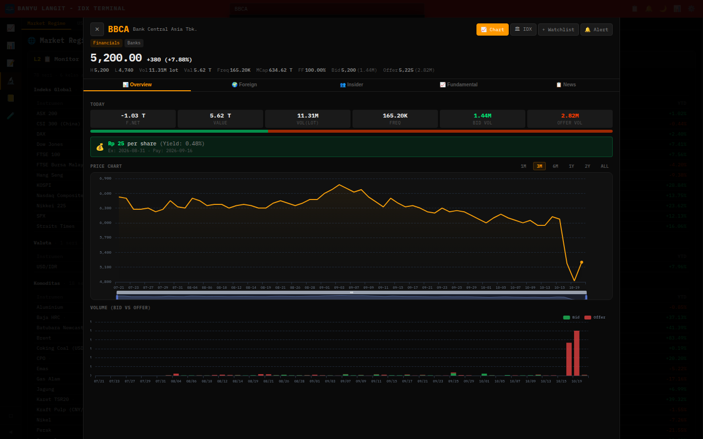

<div align="center">

# 🌊 Banyu Langit

**IDX Terminal — market analytics, research workspace and trading diary for the Indonesian stock market.**

Self-hosted · single SQLite file · no subscription · runs on a mini PC


</div>



---

## What it is

Banyu Langit is a self-hosted terminal for IDX (Indonesia Stock Exchange) data. It ingests daily
market data from the exchange and a set of macro/commodity sources into one SQLite database, then
exposes it as a dense, keyboard-driven dashboard: market breadth, foreign flow, sector rotation,
per-stock fundamentals, a screener, a backtester, and a trading journal with screenshots.

It is built for one analyst working on one machine: no accounts, no multi-tenant layer, no
third-party analytics. The whole state is a single `trading.db` file plus an `uploads/` folder.

| | |
|---|---|
| **Backend** | Node.js 20 · Express 4 · 12 route modules · **172 endpoints** |
| **Database** | SQLite (`better-sqlite3`) · **61 tables** · WAL |
| **Frontend** | Vanilla HTML/CSS/JS · 24 modules · ECharts · no build step |
| **Deployment** | Docker Compose (port `3003`) or `node server/index.js` (port `3000`) |

## Screenshots

| Market intel — breadth, foreign flow, sector activity | Stock analysis — BBCA |
|---|---|
|  |  |

## Features

### Market intelligence
- **Market overview** — IHSG and global indices, breadth (advancers/decliners), total value,
  frequency, bid/offer balance, foreign net flow with a 30-day chart.
- **Sector & industry flow** — per-sector stock count and value, foreign net by sector,
  sector/industry flow timeline, sector performance ranking.
- **Market regime** — risk-on/risk-off monitor built from real yields, yield-curve slope, HY OAS,
  USD/CNY, CSI 300, turnover vs its 20-day average, and ARA/ARB extremes.
- **Commodities board** — 14 commodity groups (coal, CPO, nickel, gold, copper, oil, gas, tin,
  rubber, steel, pulp, poultry, freight, cement) with prices, changes, mapped IDX tickers,
  foreign net per group, and an explicit staleness flag per series.
- **Top movers** — gainers, losers, most active, top foreign buy/sell.
- **BEI announcements & news** — corporate announcements feed alongside market news.

### Research & analysis
- **Stock detail** — price/trading summary, foreign flow, insider view, fundamental tabs,
  news, dividends, price chart with corporate-action-adjusted history, 5-factor score,
  and a printable tearsheet.
- **Screener** — filter the universe by fundamentals and technicals, save named configurations,
  or write a custom formula.
- **Backtest** — run strategies over historical data, walk-forward, and walk-forward scoring.
- **Correlation & cross-asset** — compare tickers, cross-asset regime context, suspension list.
- **Scoring** — configurable composite score across factors.

### Journal & portfolio
- **Trading diary** — entries with screenshots, tags, and P&L tracking.
- **Portfolio** — paper trades, open/close lifecycle, settings, position builder.
- **Watchlist & alerts** — tracked tickers plus price alerts.

## Architecture

```
                    ┌────────────────────────────────────────────────┐
   browser ───────► │  public/  (vanilla JS, ECharts, 24 modules)    │
                    └───────────────┬────────────────────────────────┘
                                    │  fetch /api/*
                    ┌───────────────▼────────────────────────────────┐
                    │  server/index.js   Express 4                   │
                    │  ├── routes/  diary watchlist market idx       │
                    │  │            screener backtest portfolio      │
                    │  │            insider cross-asset rail us-daily│
                    │  ├── db.js    schema + migrations (61 tables)  │
                    │  └── scripts/ ingest, freshness, backfill      │
                    └───────┬──────────────────────┬─────────────────┘
                            │                      │
              ┌─────────────▼─────────┐   ┌────────▼───────────────┐
              │  SQLite trading.db    │   │  Upstream sources      │
              │  idx_daily,           │   │  IDX-API (daily OHLCV) │
              │  idx_fundamental,     │   │  Yahoo Finance         │
              │  financial_ratios,    │   │  investing.com series  │
              │  bei_*, ca_factors,   │   │  macro (FRED/TE)       │
              │  custom_pull_log, …   │   │  BEI/KSEI files        │
              └───────────────────────┘   └────────────────────────┘
```

Everything below the browser is one process. There is no message queue and no cache tier: requests
read SQLite directly, and ingestion runs as scheduled scripts writing into the same file.

## Quick start

### Docker (recommended)

```bash
cp .env.example .env          # then edit (see Configuration)
docker compose up -d
# open http://localhost:3003
```

The compose file mounts `./public` and `./server` into the container and runs under `nodemon`, so
edits during development reload without a rebuild. Database and uploads live in the named volumes
`tradingdiary_diary-data` and `tradingdiary_diary-uploads`, so `docker compose down` does **not**
lose data.

### Local

```bash
npm install
node server/index.js
# open http://localhost:3000
```

Requires Node.js 20 (the container is `node:20-alpine` with `python3 make g++` for
`better-sqlite3`).

## Configuration

All configuration is environment variables; secrets stay in `.env` (never committed).

| Variable | Default | Purpose |
|---|---|---|
| `PORT` | `3000` | HTTP port (compose maps `3003:3000`) |
| `DB_PATH` | `data/trading.db` | SQLite file location |
| `API_KEY` | *(empty)* | When set, `/api/v1/*` requires `x-api-key` |
| `LOG_LEVEL` | `info` | Log verbosity |
| `APP_ROOT` | repo root | Base path resolution |
| `CODE_VERSION` | *(auto)* | Stamped into freshness payloads so a response can be tied to a build |
| `RAIL_CALENDAR` | *(auto)* | Trading calendar used by the agent rail endpoints |
| `RAIL_WINDOW_START` | *(auto)* | First session the rail will consider |
| `RAIL_WRITER_SINCE` | *(auto)* | Cut-off used when deciding which writers own a series |
| `BL_DB`, `BL_URL`, `DENO_SYNC_URL` | *(empty)* | Optional bridges to an external sync service |
| `ALPHA_VANTAGE_KEY` | *(empty)* | Optional fallback price source |

## API reference

172 endpoints across 12 modules. All are JSON; every response is `{ ok, data }` or
`{ ok: false, error }`.

| Module | Endpoints | Representative routes |
|---|---:|---|
| `routes/idx.js` | 83 | `GET /api/idx/summary`, `/quote`, `/top`, `/suspended`, `/digest`, `POST /api/idx/custom/upsert` |
| `routes/insider.js` | 32 | `GET /api/insider/overview`, `/by-type`, `/network`, `/investor`, `POST /api/insider/upload` |
| `routes/screener.js` | 12 | `POST /api/screener/run`, `/formula`, `GET /api/screener/sectors`, `GET|POST /api/screener/configs` |
| `routes/watchlist.js` | 10 | `GET|POST /api/watchlist`, `DELETE /api/watchlist/:id`, `GET|POST /api/alerts` |
| `routes/portfolio.js` | 9 | `GET|PUT /api/portfolio/settings`, `GET|POST /api/portfolio/trades`, `POST /api/portfolio/trades/:id/close` |
| `routes/market.js` | 8 | `GET /api/market/overview`, `/commodities`, `/idx-indices`, `/quotes`, `/quote` |
| `routes/backtest.js` | 6 | `POST /api/backtest/run`, `/walk-forward`, `/walk-forward-score`, `GET /api/backtest/variables` |
| `routes/rail.js` | 5 | `GET /api/v1/idx/series`, `/freshness`, `/indicator`, `/scores` |
| `routes/diary.js` | 4 | `GET|POST /api/diary/entries`, `PUT|DELETE /api/diary/entries/:id` |
| `routes/cross-asset.js` | 2 | `GET /api/cross-asset`, `GET /api/suspensions` |
| `routes/us-daily.js` | 1 | `GET /api/us-daily` |
| `routes/eod-fetcher.js` | — | background EOD fetch helpers (no routes) |

`GET /api/health` is available for liveness checks.

## Data model

61 tables in one SQLite file, grouped by who owns the writes:

- **Market prices** — `idx_daily` (daily OHLCV per ticker), `daily_index`, `idx_indices`,
  `index_chart`, `top_movers`, `trading_daily`, `us_daily`, `custom_ohlc` (+`_archive`, `_rewrites`).
- **Fundamentals** — `idx_fundamental`, `financial_reports`, `quarterly_financials`,
  `financial_ratios`, `dividends`, `daily_scores`.
- **Corporate actions** — `corporate_actions`, `bei_corporate_actions`, `bei_dividends`,
  `right_offerings`, `new_listings`, `additional_listings`, `company_profiles`,
  `company_suspends`, `company_delistings`, `company_relistings`, `ca_factors`.
- **Ownership & flows** — `holdings`, `ownership_1pct`, `balance_position`, `issued_history`,
  `domestic_trading`, `foreign` flows inside `trading_daily`, `broker_summary`,
  `participant_*`, `investor_*`, `security_stocks`, `investor_overrides`, `investor_rules`.
- **Macro & commodities** — `custom_tickers`, `custom_pull_log`, `commodity_groups`,
  `market_index_constructed`, `market_calendar`.
- **Journal & app state** — `portfolio_trades`, `portfolio_settings`, `screener_configs`,
  `ticker_groups`, `sync_logs`, `upload_logs`, `header_mappings`, `_bei_upload_log`.

## Data pipeline & integrity

The interesting part of this project is not the UI, it is the bookkeeping that keeps a
patchwork of sources from silently disagreeing.

- **One source per series.** `custom_tickers` records which writer owns each non-IDX series
  (investing.com, Yahoo, macro feeds). A mixed-source guard rejects a series whose rows would
  come from two different writers.
- **Pull telemetry.** `custom_pull_log` is append-only: one row per series per pull with
  `ref_date` (the session we asked for), `source_frontier_date` (the newest date the *source*
  actually returned), rows, written and status. That is what separates three very different
  failures — *we* fell behind, the *source* publishes late, or the source **stopped**
  publishing — which otherwise all look like "stale data".
- **Corporate-action factors.** `ca_factors` holds split/dividend adjustment factors so charts,
  the screener and the overview all read one adjusted basis instead of re-deriving it three
  different ways.
- **Freshness endpoint.** `GET /api/v1/idx/freshness` reports per-table `as_of`, lag in days,
  month-completeness and the code version that produced the payload, so a caller can tell
  "empty because nothing happened" from "empty because the fetch broke".
- **Reconciliation.** Price rows are cross-checked against the exchange's own published summary
  for the latest session before a backfill is trusted.

## Automation

- Daily IDX sync (prices, indices, top movers, foreign flow) is driven by an external scheduler
  that calls the ingest endpoints; the container itself stays stateless.
- A separate market-rails timer pulls macro and commodity series inside a defined trading window
  and records each pull in `custom_pull_log`.
- `sync_logs` / `upload_logs` keep the audit trail of what ran and when.

## Project structure

```
banyu-langit/
├── server/
│   ├── index.js            Express app, static hosting, auth middleware
│   ├── db.js               schema + migrations (61 tables)
│   ├── routes/             12 route modules (172 endpoints)
│   ├── scripts/            ingest, freshness, backfill, checks
│   └── utils/              shared helpers
├── public/
│   ├── index.html          single-page shell
│   └── js/                 24 modules (market, stock detail, screener, backtest, diary, …)
├── IDX-API-main/           read-only bridge data from the IDX-API project
├── docs/screenshots/       README screenshots
├── Dockerfile              node:20-alpine + build deps for better-sqlite3
└── docker-compose.yml      port 3003, named volumes, live-reload mounts
```

## Security notes

- Set `API_KEY` and send `x-api-key` on `/api/v1/*` when the app is reachable by anything other
  than localhost.
- This is a **single-user** tool. It has no user accounts, sessions or roles; do not expose it to
  the internet. Put it behind a VPN (e.g. Tailscale) or a reverse proxy with TLS and
  authentication.
- `.env` is git-ignored and mounted read-only into the container; keep keys out of the repo.

## Known limitations

- IDX history before ~2016 is incomplete for most tickers (the upstream source simply has no rows).
- The frontend is vanilla JS with no build step, chosen for a one-machine deployment; it is not a
  component framework and is not intended for multi-developer UI work.
- SQLite + WAL is deliberate: one writer (the ingest scripts) and many readers (the UI). Heavy
  concurrent writes from multiple processes are not supported.

## Contributing

This is a personal research tool, developed in the open. Issues and suggestions are welcome;
please describe the data source and the exact endpoint when reporting data problems, and include
`GET /api/v1/idx/freshness` plus `custom_pull_log` rows for the affected series — that pair answers
most "why is this number different" questions.
